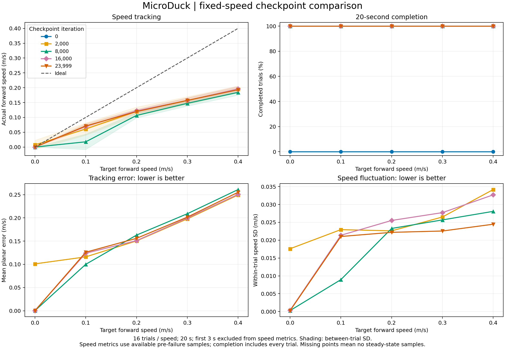
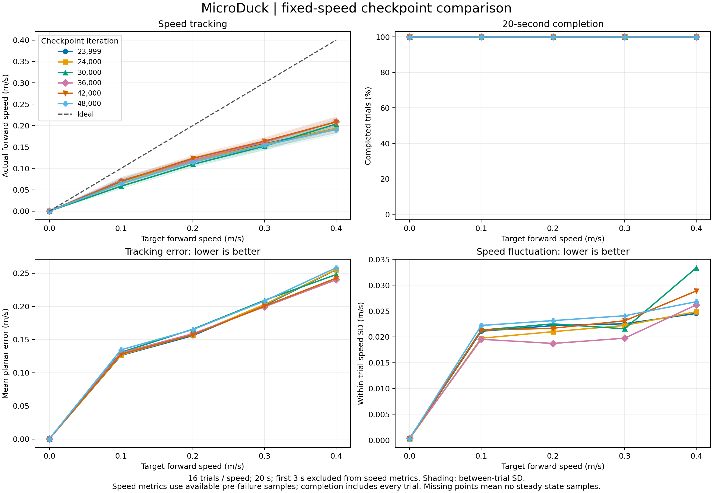

10.26 官方baseline 24000步 

# 第一次测试
| 迭代 | 目标 (m/s) | 实际前进速度 ± 试验间SD (m/s) | 平面误差 (m/s) | 速度波动 (m/s) | 航向偏差 (°) | 完成次数 | 有效稳定试验 |
|---|---|---|---|---|---|---|---|
| 23999 | 0.0 | 0.000 ± 0.000 | 0.000 | 0.000 | 2.6 | 16/16 | 16/16 |  
| 23999 | 0.1 | 0.071 ± 0.008 | 0.126 | 0.021 | 12.2 | 16/16 | 16/16 |  
| 23999 | 0.2 | 0.120 ± 0.007 | 0.156 | 0.022 | 20.0 | 16/16 | 16/16 |  
| 23999 | 0.3 | 0.157 ± 0.009 | 0.202 | 0.023 | 31.2 | 16/16 | 16/16 |  
| 23999 | 0.4 | 0.193 ± 0.010 | 0.255 | 0.024 | 53.8 | 16/16 | 16/16 |  
问题是边直走边自转 指标是偏航角yaw
# 第二次测试
| 检查点 | 指令0.1实际速度 | 指令0.2实际速度 | 指令0.3实际速度 | 指令0.4实际速度 | 移动档平均平面误差↓ | 0.4档平均朝向误差(度)↓ | 完成率 |
|---|---|---|---|---|---|---|---|
| 23999 | 0.0711 | 0.1195 | 0.1574 | 0.1932 | 0.1847 | 53.16 | 80/80 |
| 24000 | 0.0692 | 0.1175 | 0.1561 | 0.1932 | 0.1856 | 46.29 | 80/80 |
| 30000 | 0.0583 | 0.1093 | 0.1520 | 0.2037 | 0.1883 | 19.56 | 80/80 |
| 36000 | 0.0706 | 0.1192 | 0.1613 | 0.2091 | 0.1820 | 35.77 | 80/80 |
| 42000 | 0.0695 | 0.1235 | 0.1637 | 0.2086 | 0.1820 | 28.11 | 80/80 |
| 48000 | 0.0651 | 0.1148 | 0.1541 | 0.1909 | 0.1914 | 46.40 | 80/80 |

一些观察结论：
1. 目前的最大问题是速度遵循程度不高，这并不是说已经达到当前策略的最大速度，而是存在普遍性的速度偏差。例如0.1对应0.07，0.3对应0.15.在2w到5w步的模型中均表现出此特点，可以认为这里将不再随着训练而改善。

2. 第二点是自转问题，鸭子前进时，往往会同时自转，类似一个圆的轨迹，这可能也影响了第一点中的速度测量情况，所以应该确认测试中是速度还是速率？确认后再回顾第一点。实际是机体系前向速度的时间平均值，可以反应情况。偏航误差 ωz − ωz_cmd，包括带符号均值和均方根。
横滚、俯仰角速度平方和。
完整角速度奖励，以及其他奖励的实际加权贡献。

# rerun basel seed 123
第2000轮 发现向左坡行，第6000轮 变为向右 但偏航角度明显小了
步态特点：右足迈大步，左足迈小步，

10.27 测试记录（固定直行，每档16次×20秒，剔除前3秒）：

- 指令0.3 m/s时，2000/4000/6000轮实际速度分别为0.150/0.150/0.178 m/s，平均绝对航向偏移为29.5°/17.1°/18.8°；指令0.1 m/s时三者均几乎不动。
- 6000轮左右髋偏航目标均未越硬限位；动作映射符合预期，但实际关节运动范围较小，0.3 m/s时左/右膝跟踪误差RMS为0.515/0.479 rad。
- 6000轮延长决策间隔：20/40/60/80 ms分别完成16/16、16/16、15/16、2/16次；100～1000 ms均全部摔倒。40 ms双膝误差未减小，不能将原差距简单归因于电机响应慢。
- 详细记录：[模型对比](logs/evaluations/microduck_velocity/20261027_rerun_vs_previous_six_models/report.md)、[关节执行](logs/evaluations/microduck_velocity/20261027_rerun_6000_joint_tracking/report.md)、[决策间隔实验](logs/evaluations/microduck_velocity/20261027_6000_policy_hold/report.md)。
